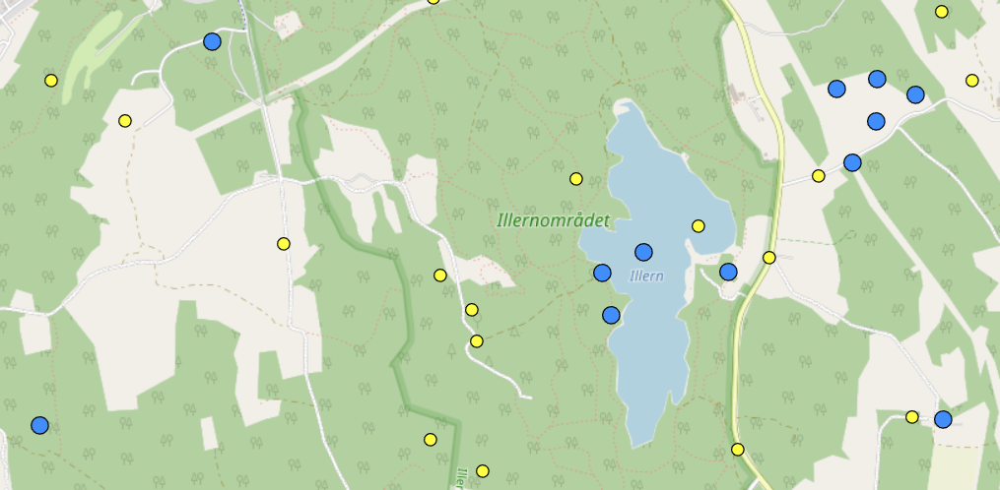
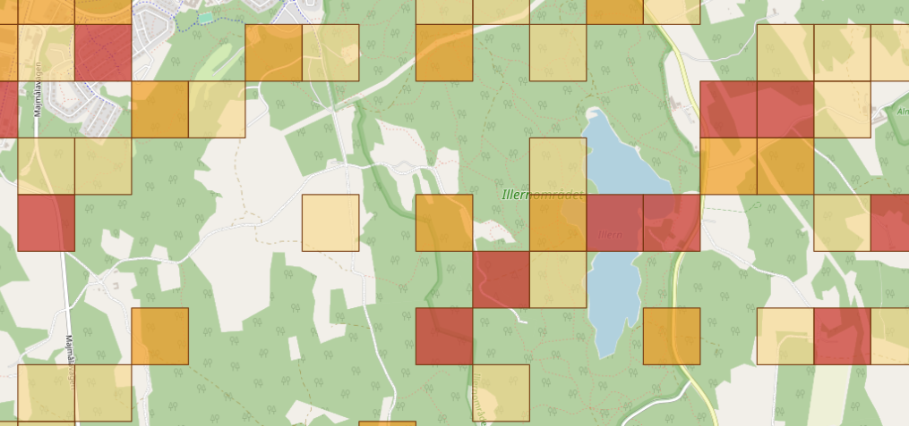

# `AdaptiveSearchLocationsInternal`

Intern endpoint för kartor med panorering och zoom. Den returnerar GeoJSON med lokaler och kluster, eller geogridrutor när ett lokalresultat blir för stort. Enskilda observationer används som underlag men returneras inte som egna poster.

## Kom igång

Skicka sökfiltret i body och kartans utsnitt och upplösning som query-parametrar:

```http
POST /observations/internal/adaptivesearchlocations?bbox=14.80,57.90,15.20,58.15&metersPerPixel=5&createPolygons=WhenNeeded
Content-Type: application/json

{
  "taxon": { "ids": [100077] }
}
```

Body är ett `SearchFilterInternalDto`; se [sökfiltrets parametrar](SearchFilter.md). `bbox` anges som `minLongitude,minLatitude,maxLongitude,maxLatitude` i WGS 84 och ersätter eventuell bbox i body. Minvärdena måste vara lägre än maxvärdena. `filter.protectionFilter` har företräde framför query-parametern `sensitiveObservations`.

Vid panorering ändras `bbox`; vid zoom ändras även `metersPerPixel`. Läs alltid `X-Result-Type` innan svaret tolkas:

| Värde | Innehåll |
|---|---|
| `locations` | Lokaler och eventuella lokalkluster. |
| `geogrid` | Gridceller med aggregerade observationsantal. |

## Sökstrategier

`Auto` är standard. `X-AdaptiveSearch-Strategy` visar vilken strategi som användes, även vid cacheträffar, tomma resultat och geogrid. Strategin och resultattypen är alltså två olika uppgifter.

| `adaptiveSearchStrategy` | Beteende |
|---|---|
| `Auto` | Väljer `LocationsThenGrid` när filtret garanterar exakt kartstatus utan brytår; annars `ObservationsThenGrid`. |
| `ObservationsThenGrid` | Bygger lokaler från alla matchande observationer när antalet är högst `observationsLimit`; annars geogrid. |
| `ObservationsThenLocationsThenGrid` | Försöker först med alla observationer, sedan med representanter om lokalgränsen tillåter det; annars geogrid. |
| `LocationsThenGrid` | Använder en representativ observation per lokal om lokalgränsen tillåter det; annars geogrid. |

För representanter måste både uppskattat och faktiskt lokalantal vara **lägre än** `locationAggregationLimit`. Kontrollen görs före sammanslagning av sammanfallande lokaler.

### När Auto använder representanter

Utan `cutoffYear` kan följande filter ge säker kartstatus med representanter:

| Filter | Lokalens status |
|---|---|
| Enbart positiva fynd, `protectionFilter=Public` | `Present` |
| Enbart positiva fynd, `protectionFilter=Sensitive` | `PresentSensitive` |
| Enbart negativa fynd och en icke-tom `invasiveSpeciesTreatmentIds` med enbart id:n ≥ 0 | `Treated` |
| Enbart negativa fynd, `hasInvasiveSpeciesTreatment=false`, `notRecoveredFilter=OnlyNotRecovered` | `NotRecovered` |
| Enbart negativa fynd, `hasInvasiveSpeciesTreatment=false`, `notRecoveredFilter=DontIncludeNotRecovered` | `NotPresent` |

Bedömningen följer sökfiltrets standardregler: utelämnad fyndstatus kan innebära enbart positiva fynd. `hasInvasiveSpeciesTreatment=true` räcker inte ensamt som garanti för `Treated`.

Övriga fall använder observationsvägen. Det gäller blandade positiva och negativa fynd, positiva fynd med `BothPublicAndSensitive`, sökningar med brytår och `createSampleObservations=true`.

## Klustring

Lokalresultat grupperas i denna ordning:

1. Sammanfallande lokaler bildar ett kartobjekt, även när klustring är avstängd.
2. Om `clusterRadiusMeters` anges körs fast meterklustring, oberoende av zoom och `cluster`.
3. Om `cluster=true` kan **högst ett** pixelsteg köras enligt tabellen nedan.

| Pixelsteg | När det används | Sökradie |
|---|---|---|
| Vanlig pixelklustring | Zoomgränsen och antalsgränsen tillåter det. | Fast sökradie på `metersPerPixel × clusterRadiusPx` meter, utan radieökning. |
| Detaljklustring | Zoom- eller antalsgränsen stoppar det vanliga steget. | Fast sökradie på `metersPerPixel × detailClusterRadiusPx` meter, utan radieökning. |

När `metersPerPixel` anges kräver vanlig pixelklustring `metersPerPixel > switchToDetailClusteringAtMetersPerPixel`, om zoomgränsen inte är `0`. Antalet klustringsbara kartobjekt måste också vara **större än** `minLocationCountBeforeClustering`, räknat efter metersteget och utan separata polygoner.

Med standardvärdena använder vanlig pixelklustring den fasta radien 20 px när upplösningen är 5 m/px, alltså 100 meter. Vid 1 m/px används i stället den fasta radien 10 px, alltså 10 meter. Zoomgränsen 2 m/px väljer pixelsteg; den anger ingen radie.

Utan `metersPerPixel` beräknas vanlig klustringsradie från bbox och resultatets utbredning och kan öka mot målet 400 kartobjekt. Zoomgränsen och detaljklustring används då inte. `cluster=false` stänger av båda pixelstegen. `detailClusterRadiusPx=0` stänger av enbart detaljklustringen.

`minLocationsPerCluster` gäller alla kluster och räknar geografiska grupper; sammanfallande lokal-id:n räknas som en grupp. Metergrupper delas inte av pixelsteget. Radierna är sökradier, inte maximal klusterutbredning: närliggande grupper kan slås ihop. Med `metersPerPixel` kan båda pixelstegen lämna fler än 400 kartobjekt; sökradien ökas inte för att minska antalet. Växling till geogrid styrs fortfarande av sökstrategin och gränserna för observationer och lokaler före klustring, inte av antalet kartobjekt efter klustring.

Lämna `clusterRadiusMeters` tom för enbart zoomstyrd klustring. Metersteget används när du också behöver en fast sökradie i meter.

## Polygoner

| `createPolygons` | Beteende |
|---|---|
| `No` | Polygonlokaler returneras som centroidpunkter och kan klustras. Standard i endpointen och API-klienten. |
| `Yes` | Oklustrade polygonlokaler behåller sin geometri. Med `metersPerPixel` kan små polygoner klustras som punkter; utan upplösning hålls alla tillgängliga lokalpolygoner utanför klustringen. |
| `WhenNeeded` | Stora polygoner returneras som ytor, små som centroidpunkter som kan klustras. Kräver `metersPerPixel`. Standard i Status-kartan. |

Med kartupplösning använder `Yes` och `WhenNeeded` samma storleksgräns: minst 10 px bredd och höjd samt en faktisk area som minst motsvarar en cirkel med 10 px diameter. Stora polygoner hålls utanför båda klustringsstegen och räknas inte mot klustringens antalsmål.

Sammanfallande polygonlokaler bedöms utifrån sin gemensamma yta. Saknas polygongeometri används centroiden. Generaliserade observationer kan även ge osäkerhetsytor.

## Svaret

Svaret är en GeoJSON `FeatureCollection`. Sökningar utan träffar, även efter en tom geografisk skärning, ger HTTP 200.

### Lokalfeatures

Lokaler kan ha punkt- eller polygongeometri. Kluster är punkter vid klustrets mittpunkt. Använd `groupingType` för att identifiera kluster; `cluster` innehåller metadata och `presentation.status` styr presentationen.

Lokalfeatures returneras i ritordning: ytor först, därefter linjer och sist punkter och kluster. Ytor sorteras fallande efter geometrins plana area i svarets WGS84-koordinater, så att mindre polygoner kan ritas ovanpå större. Polygonhål dras av och MultiPolygon använder delpolygonernas sammanlagda area. Arean beräknas en gång per geometri vid sorteringen; objekt med samma geometri-dimension och area behåller sin inbördes ordning. Sorteringen görs när svaret skrivs och gäller även cacheträffar och representativa lokaler. Inbäddade filterområden ligger före lokalfeatures; geogridens ordning ändras inte.

| Property | Betydelse |
|---|---|
| `groupingType` | `singleLocation`, `coLocatedLocations`, `meterCluster` eller `pixelCluster`. De två sista är kluster. |
| `hasMultipleLocations` | `true` när `locations.count > 1`, även för sammanfallande lokaler. |
| `observationCount` | Totalt antal matchande observationer, även när representanter används. |
| `presentation` | Kartstatus, statusräknare, brytårsstatus och känslighetsinformation. |
| `observationSummary` | Antal taxa och delräknare för observationer. |
| `locations` | Fullständiga `count` och `ids`; `items` begränsas av `AdaptiveSearchFeatureLocationsDto.MaxLocationItems` (standard 100 lokaler per feature), sorterade efter id. |
| `cluster.radiusMeters` | Använd sökradie i meter. |
| `cluster.radiusMetersMin` | Ungefärlig radie kring klusterpunkten som omsluter medlemspositionerna, utan osäkerhetsytor. |

Använd feature-id för kartobjektets identitet och `locations.ids` vid observationssökningar. Kluster-id bygger på alla medlems-id:n, oberoende av ordning och skiftläge. Gränsen för `items` gäller bara lokalernas metadata, inte klusteridentitet eller beräkning av polygongeometri.

Antalet lokaldetaljer styrs på ett enda ställe: `public const int MaxLocationItems = 100` i [AdaptiveSearchLocationFeaturePropertiesDto.cs](../Src/SOS.Api.Contracts/Observations/Responses/AdaptiveSearchLocationFeaturePropertiesDto.cs), i klassen `AdaptiveSearchFeatureLocationsDto`. För att testa större svar, ändra exempelvis konstanten till `200`, bygg om observations-API:t och starta den uppdaterade API-instansen. Gränsen gäller varje kartobjekt, även vid cacheträffar. Ett kluster med 150 lokaler kan då innehålla alla 150 detaljer, medan ett kluster med fler än 200 lokaler fortfarande har fullständiga `ids` och `count` men högst 200 `items`. Jämför svarsstorlek och svarstid med samma filter, bbox, zoom och cacheläge. Återställ konstanten till 100 och bygg om API:t efter testet. Dropdownen använder automatiskt de namn som följer med i `items`; observationstabellens separata gräns på fem observationer påverkas inte.

Med `includeFilterAreasInResult=true` tillkommer områdesfeatures märkta med `properties.FeatureType`: `FilterArea.Area`, `FilterArea.OwnPolygon` eller `FilterArea.Polygon` för en sökcirkel. De har andra properties än lokalfeatures.

### Filterytor utan upprepad överföring

Alla svar från `AdaptiveSearchLocationsInternal` innehåller `filterAreaReferences` på FeatureCollection-nivå, även när `includeFilterAreasInResult=false`. Det gäller lokalresultat, cacheträffar, tomma resultat och geogrid. Utan geografiska filter är listan tom. Referenserna är metadata och ingår inte i `X-Feature-Count`.

```json
{
  "type": "FeatureCollection",
  "filterAreaReferences": [
    {
      "featureType": "FilterArea.Area",
      "areaType": "County",
      "featureId": "1",
      "geometryUrl": "/areas/County/1/geometry"
    },
    {
      "featureType": "FilterArea.OwnGeometries"
    }
  ],
  "features": []
}
```

Exemplet visar bara relevanta fält; övriga referensfält kan vara `null`. `geometryUrl` är relativ till API:ts origin och inkluderar eventuell `PathBase`. Vid ett separat webb-/proxyursprung ska länken därför lösas mot observations-API:t. Argumenten `areaType` och `featureId` kan alltid användas för att bygga anropet mot klientens konfigurerade API-basadress. Länkarna gäller oberoende av kartans bbox och zoom. Dubbletter av samma områdestyp/id ger en referens.

Hämta lagrade områden med:

```http
GET /areas/County/1/geometry
Accept: application/geo+json
```

Svaret är en GeoJSON Feature i WGS84 utan ZIP-arkiv, med samma områdesmetadata som en inbäddad `FilterArea.Area`. Vanlig HTTP-komprimering kan användas. Ingen klippning eller förenkling görs. Okänt område eller saknad geometri ger `404`; ogiltig områdestyp ger `400`.

Endpointen returnerar `Cache-Control: public, max-age=3600` och en innehållsbaserad svag `ETag`. Spara validatorn tillsammans med geometrin. Vid omvalidering skickas den som `If-None-Match`; `304 Not Modified` saknar kropp och betyder att klientens tidigare geometri ska återanvändas. Både `200` och `304` innehåller cachehuvudena. Geometri och områdesmetadata hämtas via `AreaManager` från den befintliga `IAreaCache`. GeoJSON och ETag beräknas för varje anrop som når API:t, även vid `304`, och sparas inte i någon separat servercache. HTTP-cachen och kartans återanvändning minskar antalet sådana anrop. Underliggande områdescache påverkar när ändringar i källdatat blir tillgängliga; dess geometridictionary har ingen tidsbaserad utgång.

Egna geometrier lagras inte av sökanropet och får därför ingen serverlänk. En enda referens av typen `FilterArea.OwnGeometries` representerar hela listan i den ursprungliga begärans `geographics.geometries`, oavsett antalet geometrier. Klienten läser listan och ritar geometrierna som separata features i samma konturlager. Polygoner och MultiPolygon behåller sina koordinater och hål; ingen sammanslagning eller geometrisk union görs och sökfiltret ändras inte.

För sökcirklar behålls den befintliga hanteringen: om den första geometrin är en punkt och `maxDistanceFromPoint` är positivt, returneras i stället en `FilterArea.Polygon`-referens till den första punkten med det ursprungliga `maxDistanceFromPoint`. Bara den cirkeln visas då, precis som för inbäddade filterytor. Klienten har redan koordinaterna och kan behålla dem utan att de skickas tillbaka. En tom geometrielista ger ingen egen referens. Kartans bbox skapar ingen egen filterreferens.

Behåll filterytorna i ett separat kartlager och använd normalt `includeFilterAreasInResult=false` under zoom och panorering. Låt lagrade områdens typ/id styra klientcachen. Flaggan `true` fungerar fortfarande för klienter som vill ha geometrierna inbäddade i varje söksvar. Egna polygoner skickas fortfarande i sökbegäran; den här ändringen inför inget lagrat geometri-id för sökning.

I .NET-klienten finns `ISosAreasClient.GetAreaGeometryAsync(areaType, featureId, ifNoneMatch, cancellationToken)`. Resultatet innehåller `GeoJson`, `ETag` och `NotModified`. Läs filterreferenserna ur söksvarets `GeoJson`, exempelvis med `JsonDocument` och kontraktet `FilterAreaReferenceDto`.

### Hur exakta är värdena?

Fullständigt observationsunderlag ger exakta sammanfattningar. Representanter ger fortfarande det totala observationsantalet, men vissa sammanfattningsvärden kan vara approximativa.

| Flagga | Gäller |
|---|---|
| `isPresentationStatusApproximated` | Endast `presentation.status` och `presentation.cutoffYearStatus`. Alltid `false` för `Auto`. |
| `isSummaryApproximated` | `observationSummary`, `presentation.statusCounts` och potentiellt `presentation.isAllObservationsSensitive`. Enskilda värden kan fortfarande vara exakta. |

Flaggorna följer dessa fält, inte JSON-objektens indelning. Följande förkortade lokalresultat är därför korrekt när `Auto` använder representanter för publika, positiva fynd:

```json
{
  "type": "FeatureCollection",
  "features": [{
    "type": "Feature",
    "id": "Point_5800647_1500492",
    "geometry": { "type": "Point", "coordinates": [15.00492, 58.00647] },
    "properties": {
      "groupingType": "singleLocation",
      "observationCount": 356,
      "isSummaryApproximated": true,
      "isPresentationStatusApproximated": false,
      "presentation": {
        "status": "Present",
        "statusCounts": { "Present": 1 },
        "isAllObservationsSensitive": false
      },
      "locations": { "count": 1, "ids": ["urn:lsid:artportalen.se:site:123456"] },
      "observationSummary": { "taxaCount": 1 }
    }
  }]
}
```

Kartstatusen `Present` är säker och antalet matchande observationer är 356. Statusräknaren och artantalet bygger däremot på representanten. `statusCounts` behöver därför inte summera till `observationCount`.

En publik representant ger ett säkert `isAllObservationsSensitive=false`. Enbart skyddade representanter kan ge ett osäkert `true` om filtret även tillåter publika fynd. Ett filter med enbart skyddade fynd ger ett säkert `true`.

Flaggorna beräknas även för uttryckligen valda strategier. Kluster och svarshuvuden anger `true` om någon medlem har motsvarande flagga. Tomma resultat och geogrid ger `false` i båda svarshuvudena; filterområden får inga observationsflaggor.

### Svarshuvuden och cache

| Header | Betydelse |
|---|---|
| `X-Result-Type` | `locations` eller `geogrid`. |
| `X-AdaptiveSearch-Strategy` | Effektiv strategi efter utvärdering av `Auto`. |
| `X-Observations-TotalCount` | Totalt antal matchande observationer. |
| `X-Estimated-Location-Count` | Uppskattat antal distinkta lokaler, när uppskattning finns. |
| `X-Feature-Count` | Antal primära lokal-, kluster- eller gridfeatures, utan filterområden. |
| `X-Locations-Before-Clustering` | Lokalantal före klustring, för lokalresultat. |
| `X-Zoom` | Använd geogridnivå, för gridresultat. |
| `X-Cache` | `HIT`, `MISS` eller `BYPASS`. |
| `X-AdaptiveSearch-Timings` | Servertider; överföring och kartvisning ingår inte. |
| `X-Location-Aggregation-Mode` | `representative` när representanter används. |
| `X-Location-Summary-Approximated` | Om någon features sammanfattning kan vara approximativ enligt flaggan ovan. |
| `X-Location-Presentation-Status-Approximated` | Om någon features kartstatus kan vara approximativ enligt flaggan ovan. |

Lokalcachen används för fullständiga lokalresultat; representanter och geogrid kringgår den. Klustringen anpassas till aktuell upplösning även vid cacheträffar. När svarskomprimering är aktiverad förhandlas gzip eller Brotli med `Accept-Encoding`.

## Parameterreferens

Ogiltiga parametervärden ger HTTP 400.

### Sökning och svar

| Parameter | Standard | Tillåtna värden | Funktion |
|---|---:|---|---|
| `adaptiveSearchStrategy` | `Auto` | Strategierna ovan | Väljer observations-, representant- eller gridvägen. |
| `observationsLimit` | `10000` | `0`–`10000` | Högsta observationsantal för att hämta hela underlaget. |
| `locationAggregationLimit` | `1000` | `1`–`10000` | Representanter tillåts strikt under gränsen. |
| `maxZoom` | `21` | `1`–`21` | Högsta geogridnivå, inte kartans zoom. |
| `maxGridCells` | `10000` | `1`–`10000` | Önskad övre nivå på gridantalet; används för att välja gridzoom. |
| `bbox` | `null` | Fyra WGS 84-tal | Ersätter bbox i body. |
| `returnInputBBox` | `false` | `true`/`false` | Returnerar inmatad bbox i stället för resultatets utbredning. |
| `sensitiveObservations` | `false` | `true`/`false` | Väljer skyddade/publika fynd när `filter.protectionFilter` saknas. |
| `cutoffYear` | `null` | Heltal | Delar presentationen före och från och med året; ändrar inte sökfiltret. |
| `includeFilterAreasInResult` | `false` | `true`/`false` | Lägger till filtergeometrier som separata features. `filterAreaReferences` returneras även vid `false`. |
| `useCache` | `true` | `true`/`false` | Tillåter läsning och skrivning i lokalcachen. |
| `createSampleObservations` | `false` | `true`/`false` | Felsökningsdata för kartsymboler; `Auto` väljer observationsvägen. |

### Klustring och geometri

| Parameter | Standard | Tillåtna värden | Funktion |
|---|---:|---|---|
| `cluster` | `true` | `true`/`false` | Aktiverar de två alternativa pixelstegen. |
| `clusterRadiusMeters` | `null` | Positivt ändligt tal | Fast metersteg före pixelsteget, även vid `cluster=false`. |
| `metersPerPixel` | `null` | Positivt ändligt tal | Kartupplösning i markmeter per CSS-pixel. |
| `clusterRadiusPx` | `20` | `1`–`500` | Fast sökradie för vanlig pixelklustring i CSS-pixlar när `metersPerPixel` anges. Kan ge fler än 400 kartobjekt. Ingen garanti för maximal klusterutbredning. |
| `switchToDetailClusteringAtMetersPerPixel` | `2.0` | Icke-negativt ändligt tal | Växlar från vanlig pixelklustring till detaljklustring vid upplösning ≤ gränsen. `0` stänger av zoomväxlingen. |
| `detailClusterRadiusPx` | `10.0` | Ändligt tal `0`–`500` | Fast sökradie i pixlar för detaljklustring när zoom- eller antalsgränsen stoppar vanlig pixelklustring. `0` stänger av detaljklustringen. |
| `minLocationCountBeforeClustering` | `0` | `0`–`10000` | Vanligt pixelsteg tillåts över detta antal klustringsbara kartobjekt. |
| `minLocationsPerCluster` | `2` | `2`–`100` | Minsta antal geografiska grupper per kluster. |
| `createPolygons` | `No` | `No`, `Yes`, `WhenNeeded` | Polygonläge enligt tabellen ovan. |

## Exempel med API-klienten

Med en injicerad `ISosObservationsClient`:

```csharp
using SOS.Api.Client.Requests;
using SOS.Api.Contracts.Observations.Requests;

var response = await observationsClient.AdaptiveSearchLocationsInternalAsync(
    new SearchFilterInternalDto { Taxon = new() { Ids = [100077] } },
    new AdaptiveSearchLocationsOptions
    {
        BoundingBoxQuery = "14.80,57.90,15.20,58.15",
        MetersPerPixel = 5,
        CreatePolygons = CreatePolygonsMode.WhenNeeded
    },
    cancellationToken);
```

Läs `response.ResultType` innan `response.GeoJson` tolkas. För typade lokalfeatures finns även `ISosObservationSearchService.AdaptiveSearchLocationsInternalAsFeatureCollectionAsync`; geogrid och filterområden har andra properties än lokalernas DTO.

## Status-kartan

Första sökningen startas med **Sök**. Därefter kan panorering och zoom söka automatiskt. **Kartinfo → Använd strategi** visar strategin som servern valde.

Vid pan/zoom med samma filter behålls markeringen och observationslistan. Tabellen byter innehåll först när nya observationer har hämtats. Ett ändrat filter återställer markeringen. Klick på en punkt prioriteras framför en underliggande polygon.

Markering och avmarkering lämnar alltid kartutsnittet oförändrat. Det gäller kartklick, lokal-dropdownen och observationstabellens kryssrutor, även för polygoner som sträcker sig utanför kartutsnittet. Markering uppdaterar objektens stil och kan hämta observationer för urvalet, men anpassar inte kartans centrum eller zoom och startar därför ingen kartsökning genom en automatisk kartförflyttning. Manuell panorering och zoomning, inklusive dubbelklickszoom, fungerar som tidigare och kan utlösa automatisk kartsökning.

Under **Visning → Punktstorlek** används samma antalsbaserade skala för punkter och kluster:

| Läge | Storlek |
|---|---|
| Fast storlek | Punkter 10 px, kluster 12 px. |
| Efter antal – automatiska gränser | 10/14/18 px; gränser vid 75:e och 90:e percentilen i aktuellt punktresultat. |
| Efter antal – fasta gränser (standard) | ≤5 fynd: 10 px; 6–50: 14 px; ≥51: 18 px. |

Antalslägena använder `observationCount`. Ytor och filterområden ingår inte i automatgränserna. Visningsvalen ändrar kartan direkt utan ny sökning och påverkar inte serverns klustring. Gul klustermarkering använder den omslutande radien `cluster.radiusMetersMin`; noggrannhetscirklar och klusterradier kan visas som hjälplager.

Sökfiltrets polygoner visas automatiskt utifrån `filterAreaReferences` i ett separat lager med mörkgröna streckade konturer och utan fyllnad. Egna polygoner och sökcirklar hämtas ur det ursprungliga sökfiltret. Lagrade områden hämtas via Status-webbens `/api/areas/{areaType}/{featureId}/geometry`, som vidarebefordrar geometri och HTTP-cachevalidatorer från observations-API:t. Identiska geografiska filter återanvänder lagret under zoom och panorering; efter en timme kan geometrin omvalideras av webbläsaren. Ändrade filter ersätter konturerna och avbryter inaktuella hämtningar. Konturerna påverkar inte val av observationspunkter eller antal kartobjekt. Under **Visning → Visa sökfiltrets konturer** kan lagret döljas och visas utan en ny sökning.

Om kartutsnittet inte överlappar det valda området är resultatet tomt. När kartsvaret anger noll observationer töms observationstabellen utan ett extra förhandsvisningsanrop. Även direkta anrop till `ObservationsBySearchInternal` returnerar en tom sida med HTTP 200 när en giltig bbox får tom skärning med filterområdet. En felaktig bbox i begäran ger fortfarande HTTP 400. Webbens sökproxy vidarebefordrar API:ts felstatus i stället för att omvandla exempelvis 400 till 500.

När karturvalet omfattar flera lokaler visas en dropdown **Lokal** ovanför observationstabellen. Väljaren tillåter endast val från listan, utan textinmatning. **Alla lokaler (N)** visar observationer för hela urvalet. Välj en lokal för att begränsa tabellsökningen på servern och framhäva lokalens befintliga kartobjekt; en klustermedlem framhäver klustret. Kartan panoreras eller zoomas inte av lokalvalet. Samtliga `locations.ids` går att välja, även när klustret innehåller fler lokaler än detaljgränsen `MaxLocationItems`. Namn visas tillsammans med id där namn finns i `locations.items`; annars visas enbart id. Rensning återgår till alla lokaler. Ett nytt karturval eller ändrat sökfilter återställer valet; panorering och zoomning med samma sökfilter behåller det. Tabellen visar fortfarande högst fem observationer, och inaktuella svar från tidigare lokalval ignoreras.





## För befintliga anrop

- Utelämnade parametrar använder standardvärdena ovan, även vid cacheträffar och för äldre anrop. Kartupplösning medför alltså zoomgränsen 2 m/px och den lilla pixelradien 10 px om de inte anges.
- `locationAggregationLimit` är ett icke-nullbart heltal med standardvärdet 1000, även för äldre strategier med representantsteget. Klientkod som tilldelar `null` måste ändras. Välj `ObservationsThenGrid` för att hoppa över representantsteget.
- `clusteringAlgorithm` och klientegenskapen `ClusteringAlgorithm` har tagits bort. Klustringen använder FastGreedy i SWEREF99 TM.
