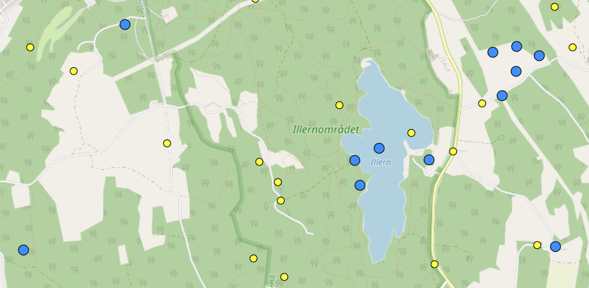
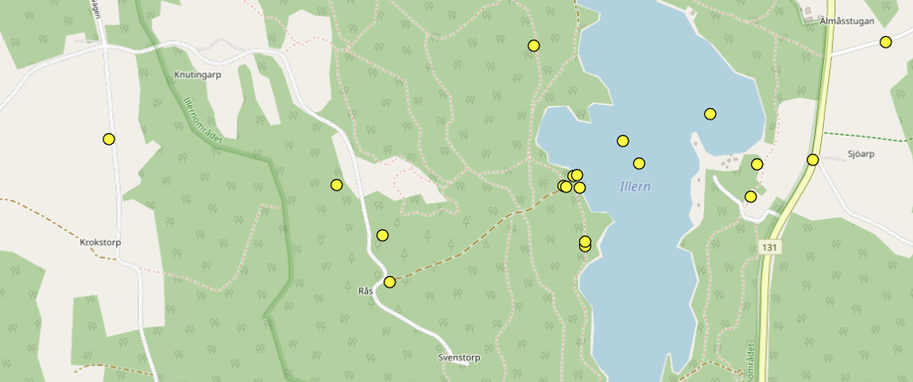
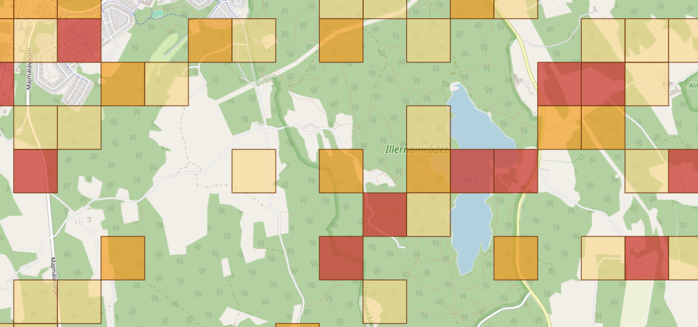
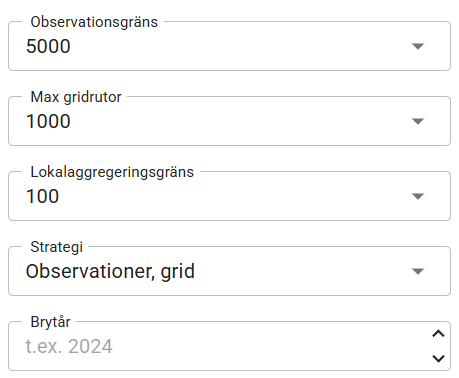

# `AdaptiveSearchLocationsInternal`

`AdaptiveSearchLocationsInternal` är en intern endpoint som söker observationer och anpassar svarets detaljnivå efter träffmängden. Samma anrop kan därför returnera antingen lokaler och lokalkluster eller aggregerade geogridrutor. Syftet är att ge ett användbart GeoJSON-lager utan att klienten först behöver räkna träffar och därefter välja en separat sökendpoint.

Endpointen passar främst för interaktiva kartor där sökfiltret är relativt stabilt medan kartans utbredning ändras vid panorering och zoomning.

> **Intern endpoint:** Endpointen exponeras i de interna API-definitionerna och ska inte betraktas som en publik SOS-endpoint.

## Översikt

| Egenskap | Värde |
|---|---|
| Sökväg | `/observations/internal/adaptivesearchlocations` |
| Request body | `SearchFilterInternalDto` som JSON |
| Svar | GeoJSON `FeatureCollection` |
| Resultattyper | `locations` eller `geogrid` |

## Vad endpointen gör

## Vad endpointen gör

Endpointen hanterar hela flödet från sökfilter till färdigt kartlager:

1. Sökfiltret och kartans bbox används för att hitta matchande observationer/lokaler, estimera antalet lokaler och bestämma resultatutbredningen.
2. Den valda sökstrategin och gränsvärdena avgör vilken detaljnivå som är lämplig:
   - exakta lokalsammanfattningar baserade på samtliga observationer som matchar sökfiltret,
   - representativa lokalsammanfattningar baserade på en observation per lokal,
   - eller aggregerade geogridrutor.
3. Lokalresultat kan visas som punkter eller polygoner och vid behov grupperas i kluster.
4. Resultatet returneras som GeoJSON tillsammans med HTTP-huvuden som beskriver resultattyp och antal.

> Observationerna används som underlag för beräkningarna men returneras inte som enskilda poster. Svaret innehåller alltid lokaler, lokalkluster eller geogridrutor.

## Hur resultattypen väljs

### Sökstrategier

| `adaptiveSearchStrategy` | Beslutsordning |
|---|---|
| `ObservationsThenGrid` | Returnerar exakta lokalsammanfattningar när antalet observationer är högst `observationsLimit`; annars returneras geogrid. Detta är standardstrategin. |
| `ObservationsThenLocationsThenGrid` | Försöker först göra exakta lokalsammanfattningar. Om observationsgränsen överskrids kan representativa lokaler användas när `locationAggregationLimit` är satt och lokalantalet ligger under gränsen; annars returneras geogrid. Användbart vid t.ex. fågelsjöar med få lokaler men många observationer. |
| `LocationsThenGrid` | Hämtar max en observation per lokal (representant) när `locationAggregationLimit` tillåter det; annars returneras geogrid. **Detta är den snabbaste strategin**.|


### Exakta och representativa lokalsammanfattningar

Ett exakt lokalresultat byggs från samtliga matchande observationer inom `observationsLimit`. Antal för taxa, status och övriga sammanfattningar kan då beräknas från hela underlaget.

Ett representativt lokalresultat hämtar en representativ observation per lokal och kompletterar den med totalt observationsantal per lokal. Vissa egenskaper, exempelvis status- och taxasammanfattningar, kan därför vara approximativa. Detta markeras på följande sätt:

- `X-Location-Aggregation-Mode: representative`
- `X-Location-Summary-Approximated: true`
- `properties.isSummaryApproximated: true` på berörda features

### Geogrid

När ett lokalresultat skulle bli för stort returneras gridceller. Zoomnivån väljs med hjälp av aktuell bbox, `maxGridCells` och `maxZoom`. Gridresultat cachelagras inte av endpointens lokalcache.

Klienten ska alltid läsa `X-Result-Type` innan resultatet tolkas eller formges:

- `locations` betyder lokaler eller kluster av lokaler.
- `geogrid` betyder polygonala gridceller med aggregerade observationsantal.

**Lokaler och kluster**
- gula prickar är lokaler och blåa prickar kluster




**Enbart lokaler**
- Varje lokal visas som en gul prick. Jämför med bilden ovan.




**Grid**
- Om det blir för många observationer/lokaler så ritas gridrutor ut.




## Request

### Body

Request body är ett `SearchFilterInternalDto`. Samma filtermodell används av övriga interna observationssökningar. En minimal body kan exempelvis vara:

```json
{
  "taxon": {
    "ids": [100077],
    "includeUnderlyingTaxa": false
  },
  "occurrenceStatus": "present"
}
```

Filterparametrarna beskrivs mer generellt i [Search filter parameters](SearchFilter.md).

### Bbox

Kartans sökområde bör normalt skickas som query-parametern:

```text
bbox=minLongitude,minLatitude,maxLongitude,maxLatitude
```

Exempel:

```text
bbox=14.80,57.90,15.20,58.15
```

Koordinaterna är WGS 84 och måste uppfylla `minLongitude < maxLongitude` samt `minLatitude < maxLatitude`. Om både query-parametern och `filter.geographics.boundingBox` finns används query-parametern. Det gör det möjligt att hålla det semantiska sökfiltret stabilt och bara ändra kartans aktuella utsnitt.

Om filterinitialiseringen ger en tom geografisk skärning returneras ett giltigt, tomt `locations`-resultat med HTTP 200.

### Query-parametrar för sökstrategin

| Parameter | Standard | Tillåtna värden | Beskrivning |
|---|---:|---|---|
| `observationsLimit` | `10000` | `0`–`10000` | Högsta observationsantal som får hämtas för ett exakt lokalresultat. |
| `maxZoom` | `21` | `1`–`21` | Högsta zoomnivå för geogrid. |
| `maxGridCells` | `10000` | `1`–`10000` | Underlag för val av gridzoom och önskad övre nivå på antalet gridceller. |
| `locationAggregationLimit` | `null` | `1`–`10000` | Gräns för när representativa lokaler får användas. Kräver en strategi med lokalsteget. |
| `adaptiveSearchStrategy` | `ObservationsThenGrid` | Se strategitabellen ovan | Styr beslutsordningen mellan exakta lokaler, representativa lokaler och grid. |
| `bbox` | `null` | Fyra WGS 84-tal | Kartans bbox. Ersätter bbox i request body. |
| `returnInputBBox` | `false` | `true`/`false` | Returnerar inmatad bbox i GeoJSON när den är `true`; annars används resultatets utbredning. |
| `includeFilterAreasInResult` | `false` | `true`/`false` | Lägger till områdespolygoner från filtret som separata GeoJSON-features. |
| `useCache` | `true` | `true`/`false` | Använder cachat resultat om det finns. |
| `cutoffYear` | `null` | Heltal | Delar upp presentationen av observationer före och från och med ett brytår. Påverkar presentationen, inte vilka observationer som matchar filtret. |



### Query-parametrar för klustring och geometri

| Parameter | Standard | Tillåtna värden | Beskrivning |
|---|---:|---|---|
| `cluster` | `true` | `true`/`false` | Aktiverar klustring av lokalresultat. Påverkar inte geogrid. |
| `metersPerPixel` | `null` | Positivt ändligt tal | Kartans upplösning i markmeter per CSS-pixel. Används för skärmbaserad klusterradie och polygonval. |
| `clusterRadiusPx` | `40` | `1`–`500` | Klusterradie i CSS-pixlar. |
| `minLocationsPerCluster` | `2` | `2`–`100` | Minsta antal distinkta lokaler som får bilda ett kluster. |
| `minLocationCountBeforeClustering` | `100` | `0`–`10000` | Klustring börjar först när antalet distinkta lokaler är större än värdet. |
| `createPolygons` | `No` | `No`, `Yes`, `WhenNeeded` | `No` ger centroidpunkter, `Yes` använder lokalpolygoner och `WhenNeeded` använder polygoner när de är tillräckligt stora i aktuell kartupplösning. `metersPerPixel` är obligatorisk när `createPolygons=WhenNeeded`.|

## Response

### Svarshuvuden

| Header | När den finns | Betydelse |
|---|---|---|
| `X-Result-Type` | Alltid vid HTTP 200 | `locations` eller `geogrid`. Styr hur body ska tolkas. |
| `X-Observations-TotalCount` | Alltid vid HTTP 200 | Totalt antal observationer som matchar sökningen. |
| `X-Estimated-Location-Count` | När estimering finns | Estimerat antal distinkta lokaler före klustring. |
| `X-Feature-Count` | Alltid vid HTTP 200 | Antal primära lokal-, kluster- eller gridfeatures. |
| `X-Locations-Before-Clustering` | För lokalresultat | Antal lokaler innan klustring. |
| `X-Zoom` | För geogrid | Zoomnivån som användes vid gridaggregeringen. |
| `X-Location-Aggregation-Mode` | För representativa lokaler | Värdet `representative`. |
| `X-Location-Summary-Approximated` | Alltid vid HTTP 200 | Anger om minst en lokalsammanfattning i svaret är approximativ. |

### GeoJSON för `locations`

Varje primär feature representerar en lokal eller ett kluster. Geometrin kan vara:

- `Point` för en enskild lokal visad som centroid.
- `Polygon` eller `MultiPolygon` när lokalens geometri ska visas.
- `Point` för ett kluster, placerad vid klustrets centroid.

De viktigaste egenskaperna är:

| Property | Beskrivning |
|---|---|
| `isCluster` | `true` när featuren grupperar flera lokaler. |
| `observationCount` | Totalt observationsantal i lokalen eller klustret. |
| `isSummaryApproximated` | Anger att delar av sammanfattningen bygger på representativa observationer. |
| `cluster` | Klusterradie och minsta inneslutande radie för ett kluster. |
| `presentation` | Övergripande presentationsstatus, statusantal och eventuell brytårsstatus. |
| `locations` | Antal och id:n för underliggande lokaler samt lokaldetaljer för en oklustrad feature. |
| `observationSummary` | Antal taxa och observationsantal för olika statuskategorier. |

Förkortat exempel:

```json
{
  "type": "FeatureCollection",
  "bbox": [14.80, 57.90, 15.20, 58.15],
  "features": [
    {
      "type": "Feature",
      "id": "urn:lsid:artportalen.se:site:123456",
      "geometry": {
        "type": "Point",
        "coordinates": [15.00492, 58.00647]
      },
      "properties": {
        "isCluster": false,
        "observationCount": 12,
        "isSummaryApproximated": false,
        "cluster": null,
        "presentation": {
          "status": "Present",
          "statusCounts": {
            "Present": 12
          }
        },
        "locations": {
          "count": 1,
          "ids": ["urn:lsid:artportalen.se:site:123456"],
          "location": {
            "locationId": "urn:lsid:artportalen.se:site:123456",
            "locality": "Exempellokal",
            "decimalLongitude": 15.00492,
            "decimalLatitude": 58.00647
          }
        },
        "observationSummary": {
          "taxaCount": 3,
          "statusCounts": {
            "foundCount": 12,
            "treatedCount": 0,
            "diffusedCount": 0,
            "redlistedCount": 2,
            "invasiveInSwedenCount": 0
          }
        }
      }
    }
  ]
}
```

Exemplet visar strukturen och är inte en fullständig uppräkning av alla valfria properties.

### Filterområden i svaret

Med `includeFilterAreasInResult=true` läggs geografiska områden från sökfiltret till i samma `features`-array. De identifieras av `properties.FeatureType`, exempelvis `FilterArea.Area` eller `FilterArea.OwnPolygon`. De är hjälpoverlay och följer inte kontraktet för en lokalfeature.


## Exempel med `Sos.Api.Client`

Klientanropet returnerar GeoJSON tillsammans med de typade svarshuvudena:

```csharp
using SOS.Api.Client.Abstractions;
using SOS.Api.Client.Requests;
using SOS.Api.Contracts.Observations.Requests;
using SOS.Api.Contracts.Observations.Responses;

public sealed class LocationMapSearch(ISosObservationsClient observationsClient)
{
    public async Task<AdaptiveSearchLocationsResponse> SearchAsync(
        CancellationToken cancellationToken)
    {
        var filter = new SearchFilterInternalDto
        {
            Taxon = new TaxonFilterDto
            {
                Ids = [100077],
                IncludeUnderlyingTaxa = false
            }
        };

        var options = new AdaptiveSearchLocationsOptions
        {
            BoundingBoxQuery = "14.80,57.90,15.20,58.15",
            ObservationsLimit = 5000,
            MaxGridCells = 1000,
            AdaptiveSearchStrategy = AdaptiveSearchLocationsStrategy.ObservationsThenGrid,
            Cluster = true,
            ClusterRadiusPx = 20,
            CreatePolygons = CreatePolygonsMode.Yes,
            UseCache = true
        };

        var response = await observationsClient.AdaptiveSearchLocationsInternalAsync(
            filter,
            options,
            cancellationToken);

        // Kontrollera response.ResultType innan response.GeoJson tolkas.
        return response;
    }
}
```

`ISosObservationSearchService.AdaptiveSearchLocationsInternalAsFeatureCollectionAsync` kan användas för att läsa ett `locations`-svar som `AdaptiveSearchLocationsFeatureCollectionDto`. Kontrollera ändå `Response.ResultType`: geogrid och tillagda filterområden har andra properties än de typade lokalfeatures som DTO:n beskriver. För generella adaptiva kartlager är därför den råa `GeoJson`-strängen ofta det säkraste gränssnittet.